


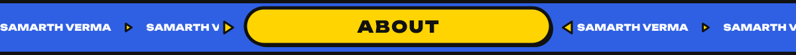
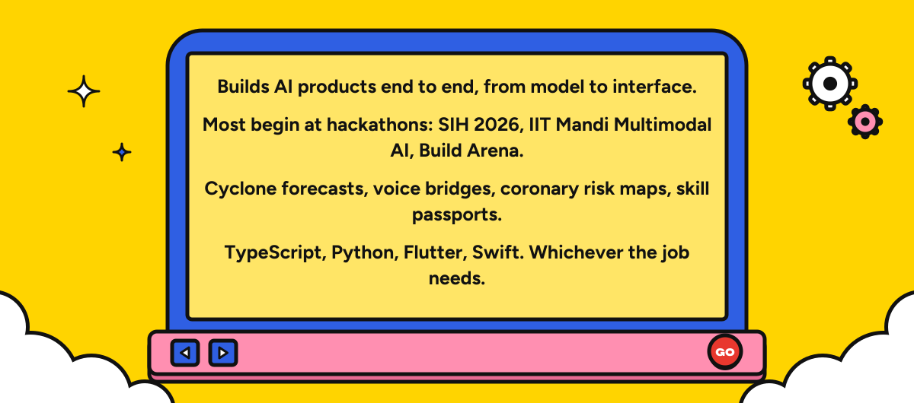
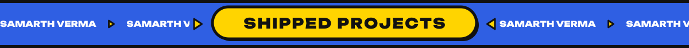
<a href="https://github.com/samarthverma4/VaayuDrishti">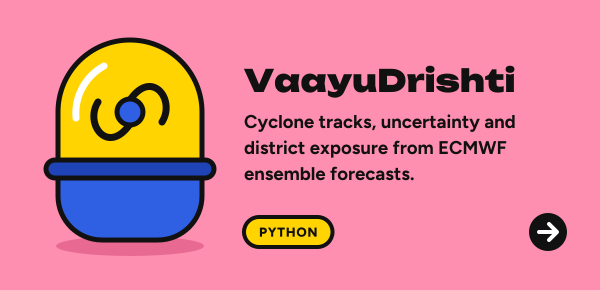</a>
<a href="https://github.com/samarthverma4/yogyata">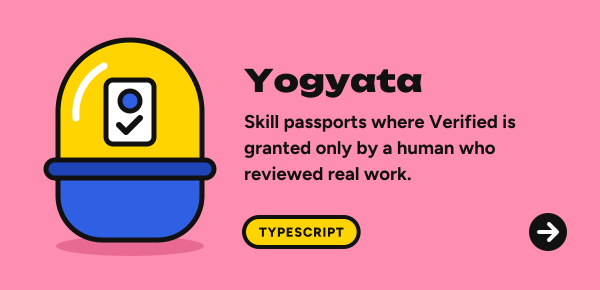</a>
<a href="https://github.com/samarthverma4/VaaniSetu">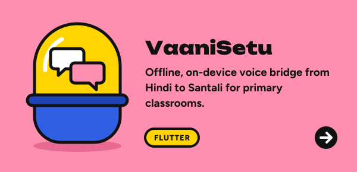</a>
<a href="https://github.com/samarthverma4/CardioMap">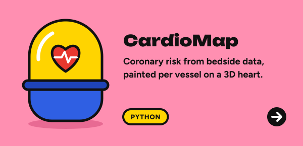</a>
<a href="https://github.com/samarthverma4/noEffortLab">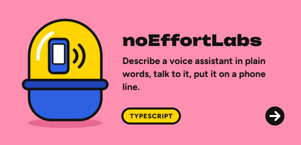</a>
<a href="https://github.com/samarthverma4/over-ear">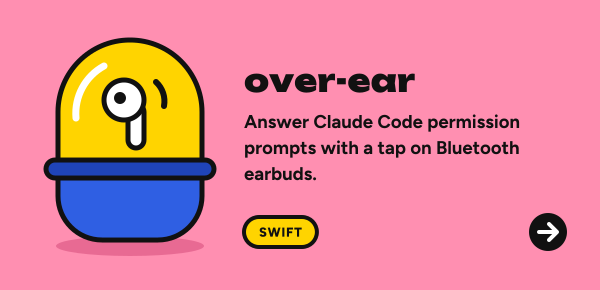</a>
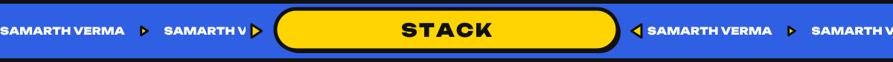
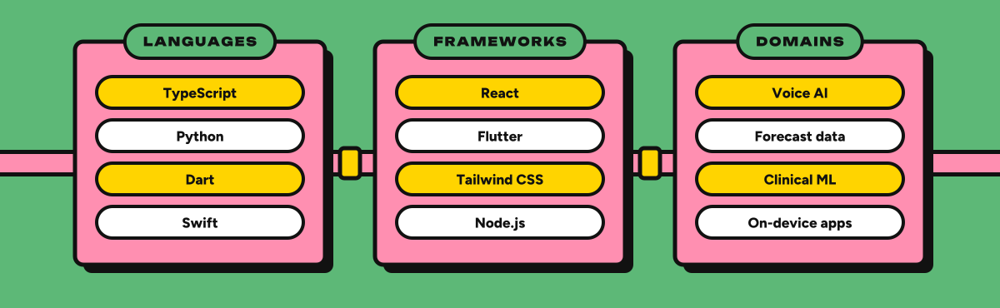
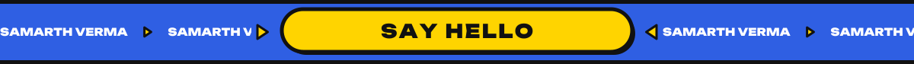

<a href="https://linkedin.com/in/sam444">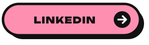</a>

Artwork is generated by <a href="scripts/build.py">scripts/build.py</a>. Built with help from Claude.
